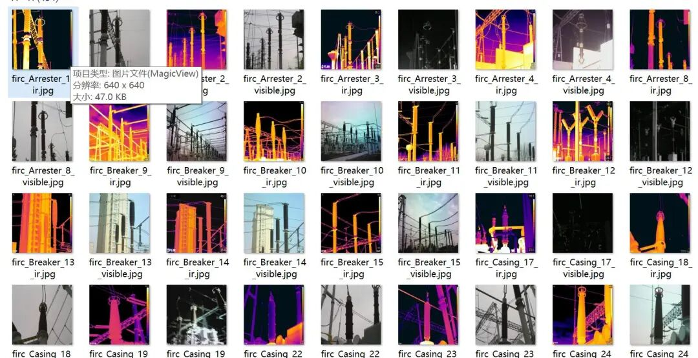
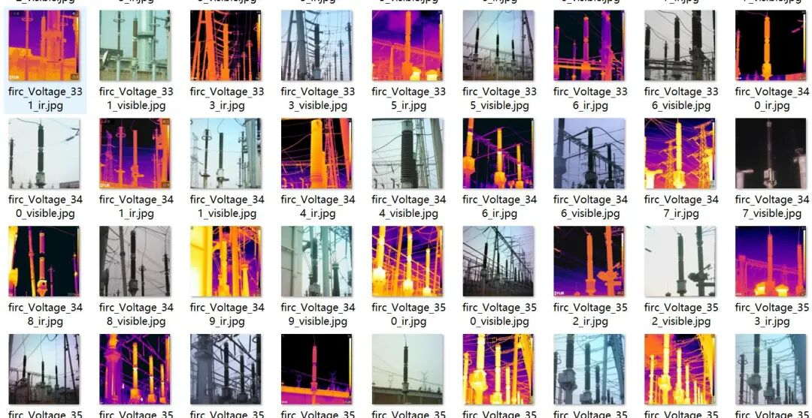
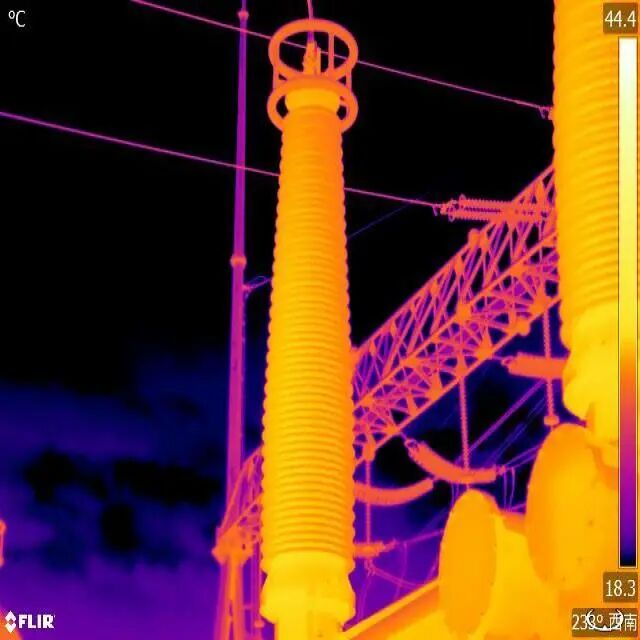
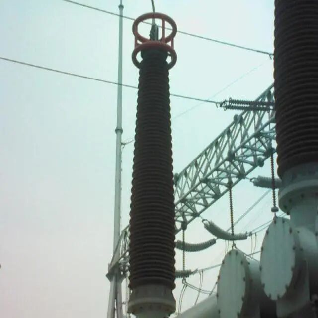

# Power Equipment Infrared Image and Visible Light Image Alignment Dataset: 205 pairs, totaling 410 unlabeled images

## Power Equipment Infrared and Visibility Image Alignment Dataset

### Dataset Overview

This dataset contains 205 pairs of infrared and visible light images for image registration research. All images are unlabeled, and researchers need to perform feature matching and estimate transformation matrices on their own.

### Dataset Structure

```
c:\Users\Administrator\Downloads\data\
└── JPEGImages\
├── firc_{device type}_{number}_ir.jpg # Infrared image
└── firc_{device type}_{number}_visible.jpg # Visibility image
```

### Equipment Type

|

Equipment type

 ||

Notes

 ||

Quantity (estimated)

 |

|

Arrester

 ||

Lightning arrester

 ||

~5 to the right

 |
|

Breaker

 ||

Circuit breaker

 ||

~7 to

 |
|

Casing

 ||

Coil

 ||

~20 pairs

 |
|

Current

 ||

Current transformer

 ||

~35 pairs

 |
|

Knife

 ||

Switch

 ||

~80 pairs

 |
|

Voltage

 ||

Voltage transformer

 ||

~80 pairs

 |

### Naming Rule

-

• Infrared Image: `firc_{device type}_{number}_ir.jpg`

-

Visible light images: `firc_{device type}_{number}_visible.jpg`

-

• Images from different perspectives of the same device share the same device type and number.

### Data Description

-

• **Image Format**: JPEG

-

• **Number of Image Pairs**: 205 pairs (total 410 images)

-

• **Image Size**: 640x640

-

• **Labeling status**: No labeling

### Notes

-

• Infrared and visible light images may have differences in perspective and scale.

-

• Some images may have higher registration difficulty due to acquisition conditions.

-

• Suggestions for data preprocessing to improve registration success rate

Image Preview:



Insert image description here.



Insert image description here.

Image pair example (note the text display in the corner area of the infrared image, and a similar progress bar on the right):



Insert image description here.



Insert image description here.


## Payment

Here is a pay link on Stripe ( https://buy.stripe.com/3cs8yP7sY87d0vu9AB ). Please contact me lonlonago@foxmail.com after funding $89, and I will send you a complete data files , thank you!


